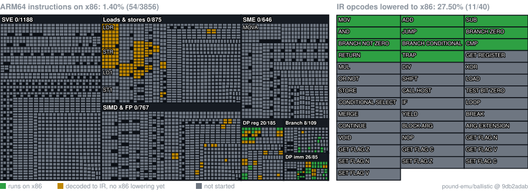
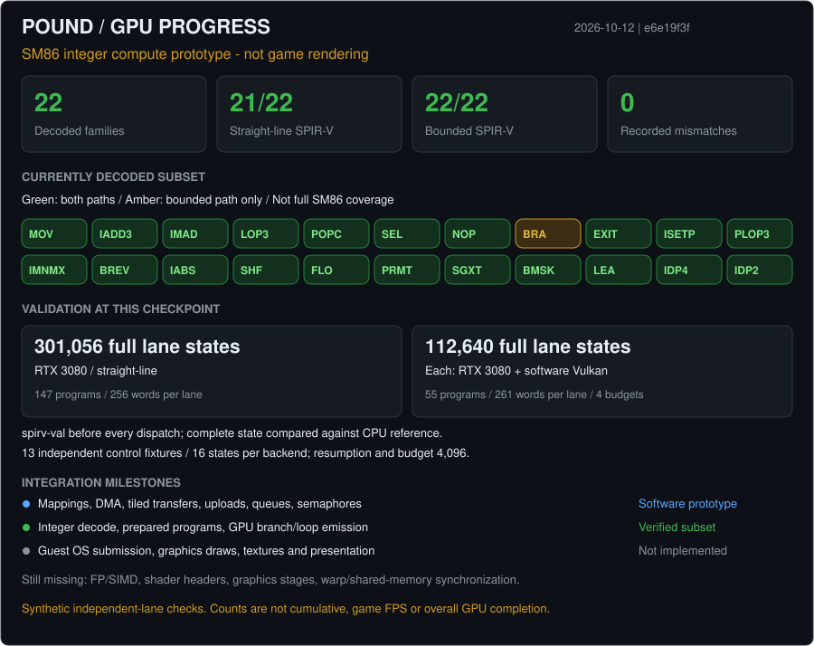

<h1 align="center">
  
    
  
  
    
  Pound
</h1>

<em>“i think of getting pounded when i see that [name]” – Satisfied Customer</em>

## Overview

**IMPORTANT: IN ORDER TO SQUEEZE AS MUCH PERFORMANCE FOR SWITCH 1 AND 2 EMULATORS, DEVELOPMENT HAS FULLY SHIFTED TO
CREATING A [NEW ARM RECOMPILER](https://github.com/pound-emu/ballistic) FROM THE GROUND UP. IF YOU ARE A COMPILER
DEVELOPER PLEASE GIVE US YOUR SUPPORT**

- [ ] Translate SM86 to SPIR-V to Vulkan.
- [X] Add `mimalloc` for host allocator.
- [ ] Create a custom pool / slab allocator for Horizon OS.
- [ ] Create a JIT code cache memory allocator for Ballistic.
- [ ] Create a JIT metadata manager.
- [ ] Integrate Ballistic into Pound.

<!-- POUND-STATUS:BEGIN -->
## Status

  

* ARM64: share of the 3856 A64 encodings in Ballistic's decoder table that its x86 tier-1 compiler can run (54 run, 201 decoded only, 3601 not started). Ballistic commit `9db2adab`.

<!-- POUND-GPU-STATUS:BEGIN -->
### GPU progress

**[GPU status details](docs/status/GPU_STATUS.md)** - checkpoint `e6e19f3f` (2026-10-12).
The decoded integer prototype covers 22 SM86 families: 21 in the straight-line SPIR-V path
and all 22 in the bounded branch/loop path. At this checkpoint,
301,056 complete straight-line lane states pass on RTX 3080; 112,640 bounded states pass
**on each of RTX 3080 and software Vulkan**. These synthetic checks are not an
overall GPU completion percentage or evidence that games render.

[GPU development details](docs/GPU_DEVELOPMENT.md) cover the software DMA,
tiled transfers, inline uploads, mappings, queues, cooperative scheduling and
semaphore prototypes. Guest OS submission and production rendering remain
unimplemented. CPU status above is a separate Ballistic snapshot and is not
refreshed by this GPU update.

Regenerate GPU visuals with `python tools/status/generate_gpu_status.py`.
<!-- POUND-GPU-STATUS:END -->

Regenerate the CPU snapshot with `python tools/status/generate_status.py --ballistic <path-to-ballistic-checkout>`.
<!-- POUND-STATUS:END -->

## Development

Pound actively supports Linux and Windows with the Clang compiler only. I cannot run Pound on Windows, so the Windows
builds will fall behind Linux builds. I would appreciate any Windows specific contributions greatly.
